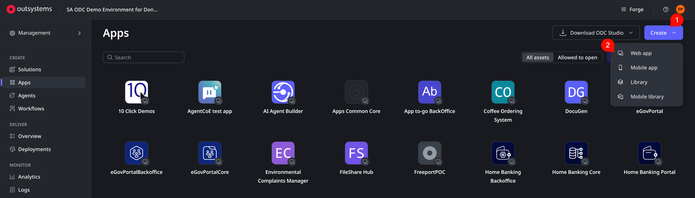
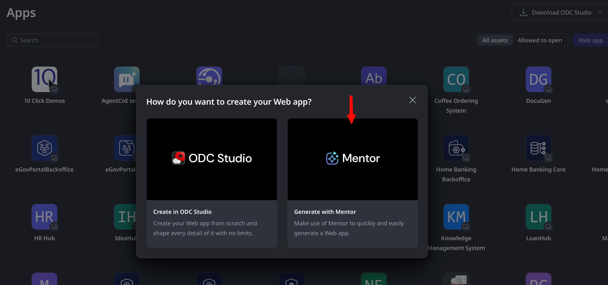
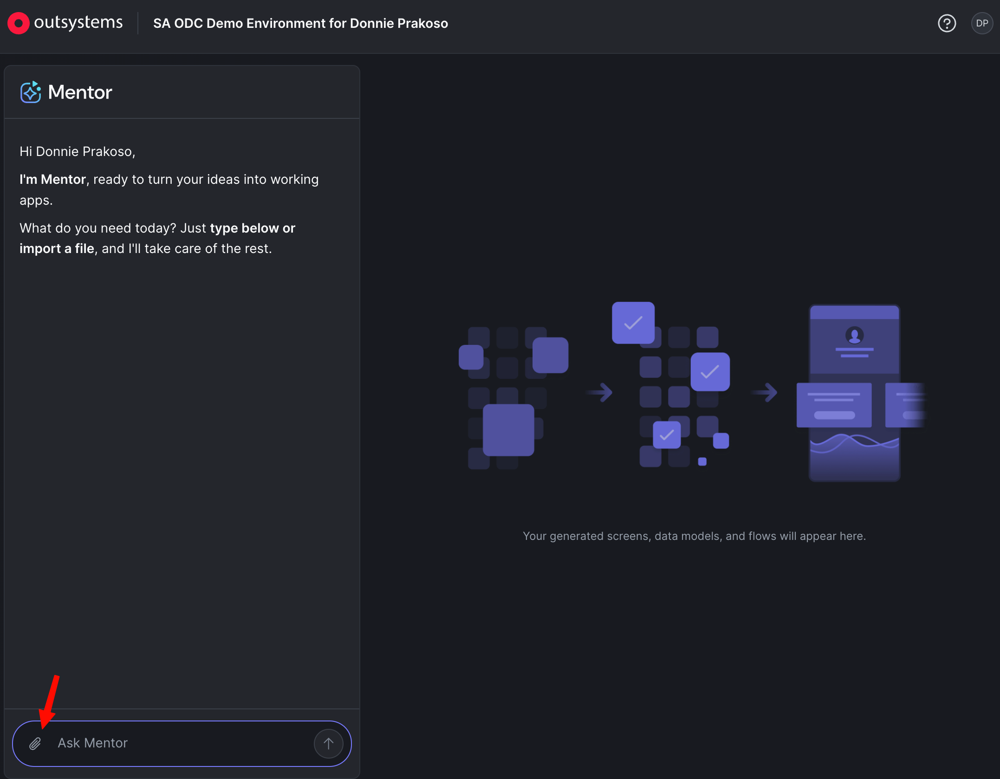
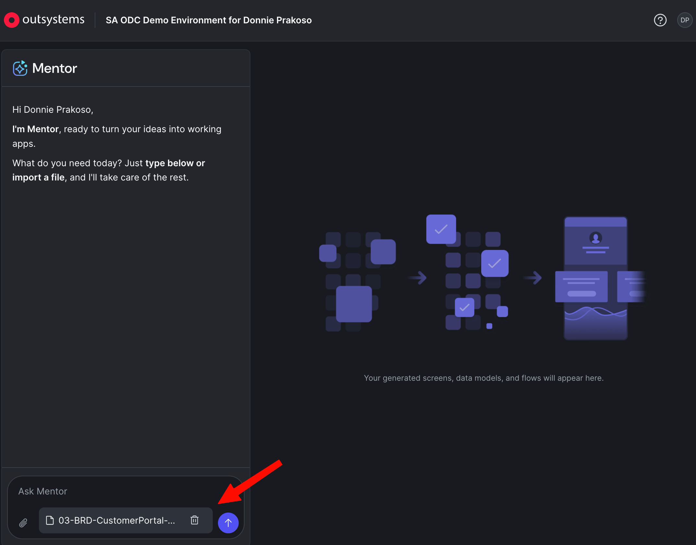

## Overview

<a href="https://success.outsystems.com/documentation/outsystems_developer_cloud/agentic_development/ai_app_generation_in_mentor_web/" target="_blank">Mentor</a> accepts either short prompts or [structured requirement documents](https://success.outsystems.com/documentation/outsystems_developer_cloud/agentic_development/ai_app_generation_in_mentor_web/use_requirement_documents/) as input. For anything beyond a simple app, a well-structured requirement document produces a far more accurate blueprint — but writing one that Mentor actually parses correctly (the right data types, list-based entity syntax, recognized screen patterns, no PII) takes some understanding.

In this workshop, you'll use [**outsystems-mentor-brd**](https://github.com/donnieprakoso/mcp-outsystems-docs/tree/main/SKILLS) — a custom skill for Claude Code — to co-build that document instead of writing it from scratch. The skill interviews you like a business analyst would, researches Mentor's current documentation live, and produces a requirement document formatted the way Mentor expects. By the end, you'll have a Mentor-ready BRD for a fictional inventory management dashboard.

## What You'll Learn

- How to link a custom skill into Claude Code from a cloned repo
- How to run an interactive requirements interview with an AI agent
- How the skill grounds its output in Mentor's live documentation instead of guessing
- What "Mentor-ready" actually means structurally, and why it matters
- What you get out the other side, and what to do with it next

## Prerequisites

- Complete <a href="/workshops/setting-up/" target="_blank">Setting Up for OutSystems Workshops</a>, specifically **Workshop Requirement 2** (OutSystems Docs MCP) — this workshop builds directly on that clone
- Claude Code installed (see <a href="https://docs.claude.com/en/docs/claude-code" target="_blank">the official docs</a>)

---

## Context

Imagine a retail operations team that's outgrown its spreadsheet. They need a dashboard: what's in stock, what's running low, what needs reordering. Before anyone opens Mentor, someone has to write down what this application actually needs to do. That's the requirement document this workshop teaches you to co-build.

---

## Step 1: Confirm Your OutSystems Docs MCP Setup

1. Open a terminal in the folder where you cloned the OutSystems Docs MCP repo during Setting Up
2. Confirm the skill folder is there:

```bash
ls SKILLS/outsystems-mentor-brd
```

3. You should see `SKILL.md`, `system-prompt.md`, `Mentor-Requirement-Doc-Standards.md`, and a `resources/` folder — extra files like `README.md` are normal, don't worry about them

> ℹ️ **Info**: The `outsystems-mentor-brd` skill ships inside the same repo as the OutSystems Docs MCP — if you completed Workshop Requirement 2 in Setting Up, you already have it. There's nothing separate to download.

> ⚠️ **Warning**: If `SKILLS/outsystems-mentor-brd` doesn't exist, run `git pull` in that repo to fetch the latest version before continuing.

---

## Step 2: Link the Skill into Claude Code

1. From the root of the cloned repo, go into the `SKILLS` folder
2. Run the linking script for your platform

```bash
cd SKILLS
chmod +x claude.sh
./claude.sh
```

3. You should see output like:

```text
link: outsystems-mentor-brd
Done. 1 skill(s) linked.
```

> 💡 **Tip**: This script symlinks the skill folder into `~/.claude/skills/outsystems-mentor-brd` — it doesn't copy it. If you later update the repo (`git pull`), the linked skill updates automatically, no re-linking needed.

> ℹ️ **Info**: Using a different agent? `opencode.sh` and `kiro.sh` in the same folder do the equivalent for OpenCode and Kiro.

### Windows Users

`claude.sh` needs a bash-compatible shell. Pick whichever you already have:

**Option 1 — Git Bash (simplest, comes with Git for Windows)**

Run the exact same commands from Step 2 inside Git Bash. Symlink creation works out of the box if <a href="https://learn.microsoft.com/en-us/windows/apps/get-started/developer-mode-features-and-debugging" target="_blank">Developer Mode</a> is enabled; otherwise, open Git Bash **as Administrator** once for this step.

**Option 2 — WSL**

If you're running Claude Code inside WSL already, treat it as Linux — the commands in Step 2 work unmodified.

**Option 3 — PowerShell, no bash available**

From a terminal pointed at the `SKILLS` folder, create the symlink directly (run PowerShell as Administrator, or with Developer Mode enabled):

```powershell
New-Item -ItemType SymbolicLink -Path "$env:USERPROFILE\.claude\skills\outsystems-mentor-brd" -Target ".\outsystems-mentor-brd"
```

> ⚠️ **Warning**: If none of the above work in your environment, you can copy instead of symlink — `Copy-Item -Recurse .\outsystems-mentor-brd "$env:USERPROFILE\.claude\skills\outsystems-mentor-brd"`. It works immediately, but you'll need to re-copy after every `git pull` since a copy doesn't stay in sync with the repo.

---

## Step 3: Launch Claude and Confirm the Skill Loaded

1. Start a new Claude Code session:

```bash
claude
```

2. Ask it directly:

```text
What skills do you have available for OutSystems Mentor?
```

Alternatively, run `/skills`:

```text
/skills
```

3. Claude should mention or list **outsystems-mentor-brd** in its answer, along with a short description of what it does

> ✅ **Checkpoint**: If the skill isn't listed, double-check Step 2 completed without errors, then start a fresh `claude` session — skills are loaded at session start.

---

## Step 4: Start the BRD Interview

1. In your Claude Code session, type:

```text
Create a BRD for Mentor
```
or you can directly call the skill
```text
/outsystems-mentor-brd
```

2. The skill won't generate anything yet — it starts by asking you questions, one at a time

The first questions are about the problem itself:

> **Claude asks:** "What problem are you solving?"
>
> **You reply:** "Our retail operations team is tracking inventory in spreadsheets. They need a dashboard to see stock levels, what's running low, and what needs reordering."

> **Claude asks:** "Who are the primary users of this system?"
>
> **You reply:** "The operations team — maybe 10 people, checking it daily."

> ℹ️ **Info**: The skill deliberately doesn't let you skip this. A requirement document written from assumptions produces a Mentor blueprint that's technically valid but solves the wrong problem.

---

## Step 5: Continue Through the Interview

The interview keeps going through scope, workflows, integrations, and constraints:

> **Claude asks:** "What are the core workflows this system needs to support?"
>
> **You reply:** "Viewing current stock by product, flagging anything below a reorder threshold, and a simple dashboard with totals and a low-stock chart."

> **Claude asks:** "What systems does this need to connect to?"
>
> **You reply:** "Nothing external for now — this is a standalone app with its own data."

> **Claude asks:** "Does this system need AI or intelligent decision-making?"
>
> **You reply:** "No, keep it simple for now."

> 💡 **Tip**: Answering "no" here matters — it keeps the skill on the standard single-app template instead of branching into a separate AI Agent architecture, which is a different (and longer) path meant for agentic apps like the one in <a href="/workshops/jumpstart-3-build-refund-agent/" target="_blank">JumpStart 3</a>.

After a handful of exchanges, the skill pauses to confirm what it heard before moving on:

> **Claude summarizes:** "Let me recap what I'm hearing: a standalone dashboard app for tracking inventory levels and flagging low stock, used daily by a ~10-person operations team, no external integrations, no AI needed. Is that accurate?"

---

## Step 6: Let the Skill Research Mentor's Best Practices

Once you confirm, the skill doesn't just template your answers into a document from memory — it does real research first. Pay attention here, because this is what makes the output usable, not just plausible:

- It queries the **OutSystems Docs MCP** live for Mentor's current requirement-document structure, canonical data types, and screen/dashboard vocabulary — not a guess, and not frozen at whatever it last learned
- It cross-checks its own cached reference (`Mentor-Requirement-Doc-Standards.md`) against that live research, and flags it to you if the two disagree
- It opens one of the **official sample requirement documents** bundled in `resources/` and pattern-matches the draft against it directly — same section structure, same entity syntax, same phrasing conventions
- It applies rules you won't find in a generic BRD template: entity attributes must use one of nine specific data types (`Text`, `Identifier`, `Boolean`, and so on), roles get exactly `View`/`Edit`/`No Access` (not made-up tiers), and any external data source must name a Data Fabric connection that already exists in ODC — Mentor can reference a connection, not create one

> ℹ️ **Info**: This is the difference between "looks like a requirements doc" and "Mentor will actually parse this correctly." A document with the right sections but the wrong data types or a stray markdown table can still confuse the blueprint step.

---

## Step 7: Review Your Two Generated Files — Ready for Mentor

The skill produces **two files**, not one:

1. **`BRD-InventoryDashboard-[date].md`** — the Mentor-upload file. It covers App Overview, Data Model, Roles & Permissions, and Main Features & Screens, written as lists (not tables) and using only the canonical data types and recognized screen patterns
2. **`BRD-InventoryDashboard-Context-[date].md`** — a companion file with the business case, non-functional requirements, and success metrics. This one is for your own stakeholders.

Open the first file and check:

- Each entity block reads like `Entity: Product` → `Attributes include:` → a bulleted list, not a table
- Roles show `View`, `Edit`, or `No Access` per entity
- Screens reference a real pattern keyword (table, card list, dashboard, and so on) rather than a vague description

> ✅ **Checkpoint**: If you open the Mentor-upload file and see markdown tables for the data model or roles, something drifted from the skill's rules — worth flagging, but this is exactly the failure mode the sample cross-check in Step 6 exists to prevent.

---

## Step 8: Open Mentor and Attach Your BRD

1. In <a href="https://www.outsystems.com/low-code-platform/developer-cloud" target="_blank">ODC Studio</a> (or the ODC Portal), start creating a new web app



2. Select **Generate with Mentor**



3. In Mentor, click the **clip/attachment icon**



4. Select **`BRD-InventoryDashboard-[date].md`** — the Mentor-upload file, not the `-Context-` companion
5. Hit **Enter** or click the send arrow, and let Mentor analyze it into a blueprint



> ℹ️ **Info**: This is the same attachment step covered in <a href="/workshops/jumpstart-1-requirements-to-app/" target="_blank">JumpStart 1</a> — the only difference here is where the document came from.

> 💡 **Tip**: Keep `BRD-InventoryDashboard-Context-[date].md` around even though Mentor never sees it — it's what you'd hand to a stakeholder or teammate to sign off on scope before you generate anything.

> ✅ **Checkpoint**: Mentor should return a blueprint summary (entities, screens, roles) that matches what you described in Steps 4–5 — a dashboard app with stock-level tracking and a low-stock view, no unexpected entities or integrations.

---

## Summary

You've co-built a Mentor-ready requirement document without writing a single section from scratch. Along the way, you:

- Linked a custom Claude Code skill from a repo you already had
- Went through a real requirements interview instead of guessing at scope
- Watched the skill ground its output in Mentor's live documentation and official sample formats
- Ended up with a document split cleanly between what Mentor needs and what your stakeholders need
- Attached the Mentor-ready file directly and got a blueprint back

## Next Steps

- If you'd like to see a document like this turn into a working application, <a href="/workshops/jumpstart-1-requirements-to-app/" target="_blank">JumpStart 1: From Requirements to an Enterprise Web App</a> walks through exactly that — entirely optional, and not required to get value out of this workshop.
